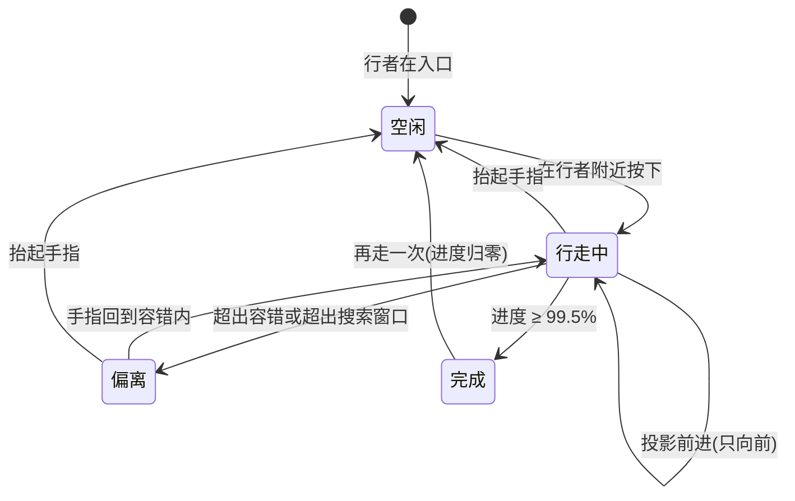

# labyrinth-walk 项目规划

## 0. 项目约定

本项目是独立项目，不引用工作区中的任何其他目录，将来可以单独作为 GitHub 仓库运行。

- **独立性：** 本文件夹有自己的 `package.json`、`package-lock.json`、`tsconfig.json`、`vite.config.ts` 和 `.gitignore`。
- **环境：** Node 20.19 或更高版本（当前 Vite 的要求），包管理器用 npm。
- **脚本：** `dev`、`build`、`preview`、`typecheck`、`test`、`test:watch`。
- **`vite.config.ts` 设置 `base: './'`：** 以后部署到 GitHub Pages 的子路径时无需修改。
- **分层：** 规则与几何放在 `src/logic/`，不引用 DOM，用 Vitest 在 Node 环境测试。视图层和输入层只负责调用规则模块和绘制。
- **调参：** 所有可调参数集中在 `src/config/tuning.ts`。
- **Git：** 本项目已于 2026-11-12 完成本地 Git 仓库初始化与基准提交（main 分支，commit 24f26ae）。

已确定的设计选择：

- 行走手感采用"先做拖着走，把容错宽度做成可调参数"。
- 第一版不做音乐和音效，只做画面变化。

## 1. 一句话定位

竖屏网页小游戏：玩家用手指带着行者，沿一条完整的盘绕小路从入口走到中心，画面随着路程慢慢变化。

## 2. 玩家核心操作

- **抓住行者：** 在行者周围 32 个 SVG 单位内按下，才算开始行走；在别处按下不会有反应。
- **拖动前进：** 手指位置投影到小路中心线上，行者跟着投影点前进。只能向前，回头拖不会后退。
- **离开小路：** 手指离中心线超过容错距离时，行者停在原地，300 ms 后淡入提示"回到小路上继续"，行者周围出现缓慢呼吸的圆环。手指回到行者附近即可继续。
- **容错可调：** 默认手感是"拖着走"；把容错距离和抓取半径调大，就接近"在路径附近滑动即可"的手感。

## 3. 最小可玩循环



## 4. MVP 功能清单

- **竖屏布局：** SVG `viewBox="0 0 360 640"`。上方是进度区，中部是直径约 330 的环形小路，下方是重开按钮。
- **程序生成小路：** 7 圈同心圆环，相邻圈之间通过 U 形转弯相连，每圈走向和上一圈相反，入口在最外圈底部，终点在中心。小路由线段和圆弧组成，同一份几何数据同时用来生成 SVG 的 `d` 字符串和计算采样点。
- **走过的部分高亮：** 在小路上叠一条较细的路径，内容是用 `slicePath` 截取的前 s 个单位。（实现时改为截取路径，没有用 `stroke-dasharray`：这样高亮长度和逻辑层的路程使用同一套长度，不依赖浏览器自己计算的路径长度。）
- **进度：** 显示 0% 到 100% 的整数和一条细进度条。
- **偏离提示：** 提示文字加行者周围的呼吸圆环。支持的设备上可选轻微震动（10 ms），iOS 不支持则跳过。
- **氛围变化：** 背景从深蓝灰渐变到暖色晨光，小路颜色同步变暖，中心光晕逐渐变亮，在 25%、50%、75% 处沿路亮起一小簇光点。系统开启"减少动态效果"时，取消光点动画，只保留颜色变化。
- **完成反馈：** 中心光晕展开，显示"你走到了中心"和用时，以及"再走一次"按钮。
- **重开：** 进度超过 10% 时点重开，先弹出确认；10% 以下直接重开。
- **防误操作：** 禁止页面滚动、缩放、下拉刷新、文字选择和长按菜单。
- **调试视图：** `?debug=1`。
- **不做音乐和音效。**

## 5. 暂时不做

音乐与音效、多张地图或地图选择、经典克里特式或沙特尔式的精确复刻、三维地图、地理定位、账号、联网、数据统计、存档续走、计步类健康数据、任何医疗或心理功效的说法。

## 6. 技术选型及理由

| 选择 | 理由 |
| --- | --- |
| 原生 TypeScript + SVG DOM，不用框架和游戏引擎 | 只有一条路径、一个行者和少量装饰。SVG 天然适合矢量路径，用 CSS 变量改颜色成本低，打包体积可以控制在几十 KB。 |
| 自己计算路径几何，不依赖 `getTotalLength()` / `getPointAtLength()` | jsdom 和 Node 测试环境不实现这些方法。自己算可以在测试里精确断言长度、连续性和投影结果；线段和圆弧的数学计算也很简单。 |
| Pointer Events 加 `setPointerCapture` | 鼠标和触摸使用同一套代码；手指移出元素时仍能收到移动事件。 |
| 坐标转换用 `svg.getScreenCTM().inverse()` | 每次事件都重新计算，屏幕旋转或缩放后仍然正确。 |
| Vite + Vitest | 热更新快，`--host` 方便手机局域网调试；Vitest 和 Vite 共用配置，测试 `src/logic/` 下的纯逻辑。 |

## 7. 建议目录结构

```
labyrinth-walk/
├─ index.html
├─ package.json / package-lock.json
├─ tsconfig.json
├─ vite.config.ts
├─ .gitignore
├─ README.md / PROJECT_PLAN.md / TODO.md
├─ public/favicon.svg
├─ src/
│  ├─ main.ts               # 组装：生成小路 → 渲染 → 绑定输入
│  ├─ style.css             # CSS 变量、防误操作样式
│  ├─ config/tuning.ts
│  ├─ logic/                # 纯 TypeScript，不引用 DOM
│  │  ├─ geometry.ts        # 线段/圆弧类型、长度、按长度取点
│  │  ├─ labyrinth.ts       # 参数 → 段列表 → SVG d 字符串
│  │  ├─ pathTrack.ts       # 采样折线、累计长度、窗口内投影
│  │  ├─ walker.ts          # 行走状态机
│  │  ├─ deviationController.ts # 偏离延时提示与振动调度 (Task 5)
│  │  ├─ duration.ts        # 用时格式化 (Task 6)
│  │  └─ atmosphere.ts      # 进度 → 颜色与强度
│  ├─ view/
│  │  ├─ svgScene.ts        # 小路、已走高亮、行者、中心
│  │  ├─ hud.ts             # 进度、提示、重开
│  │  ├─ completeOverlay.ts
│  │  └─ debugView.ts
│  └─ input/pointer.ts      # 屏幕坐标 → SVG 坐标
└─ tests/
```

## 8. 开发任务拆分

### Task 1：搭建项目骨架并显示静态 SVG

- **目标：** 跑通可运行、可测试、可构建的最小项目。
- **做法：** 用 Vite `vanilla-ts` 模板创建项目，安装 `vitest`。`index.html` 中放一个铺满 `100dvh` 的 SVG（`viewBox` 0 0 360 640），中心画一个占位圆。`style.css` 写入防误操作样式。创建 `tuning.ts`，补齐 `.gitignore` 和全部脚本。
- **测试：** 一个 `geometry.ts` 的点距函数测试，用来跑通测试流程。
- **演示：** 手机上显示占位圆，页面拖不动、缩不了。

### Task 2：生成并渲染小路

- **目标：** 屏幕上出现完整的 7 圈盘绕小路。
- **做法：** `geometry.ts` 定义线段和圆弧，提供长度计算和按长度取点。`labyrinth.ts` 根据参数生成段列表，并转换成 `d` 字符串。`svgScene.ts` 渲染小路底色、入口标记和中心。
- **测试：** 验收标准 4 的全部内容。
- **演示：** 手机和桌面上都能看到完整的小路，修改 `rings` 后圈数随之变化。

### Task 3：路径采样与窗口投影

- **目标：** 能把任意点正确投影到小路上的"当前附近"。
- **做法：** `pathTrack.ts` 按 `sampleStep` 采样成折线，记录每个点的累计长度，实现 `projectInWindow(point, sFrom, sTo)`，返回投影路程和距离。`pointer.ts` 负责坐标换算。调试视图中，鼠标悬停时显示投影点和距离。
- **测试：** 折线总长和解析长度一致；直线段、圆弧段上的投影正确；验收标准 5。
- **演示：** 打开 `?debug=1`，鼠标移动时投影点贴着小路滑动，不会跳圈。

### Task 4：拖动行走与进度显示

- **目标：** 能从入口一路拖到终点。
- **做法：** `walker.ts` 实现空闲、行走中、偏离三种状态（完成状态在 Task 6 加入），包括只能向前和单步上限。视图层渲染行者、已走高亮和进度。
- **测试：** 验收标准 6。
- **演示：** 手机上从入口拖到中心，进度从 0% 走到 100%，高亮同步延伸。

### Task 5：偏离提示

- **目标：** 偏离时给出柔和、可恢复的提示。
- **做法：** 偏离状态加入延时；HUD 淡入提示文字，行者显示呼吸圆环；检测到支持时调用 `navigator.vibrate(10)`。
- **测试：** 验收标准 7。
- **演示：** 故意把手指拖离小路，看到提示；回到行者处继续，提示消失。

### Task 6：完成与重开

- **目标：** 打通"开始 → 行走 → 到达中心 → 再走一次"的完整循环。
- **做法：** 状态机加入完成状态，记录开始和结束时间。`completeOverlay.ts` 显示中心光晕展开、完成文字和用时。重开按钮在进度超过 10% 时先确认。
- **测试：** 完成阈值；重置后状态归零；完成后的拖动不再改变状态。
- **演示：** 完整走一遍，看到完成界面，再走一次。

### Task 7：随进度变化的氛围

- **目标：** 画面随路程慢慢变化。
- **做法：** `atmosphere.ts` 根据进度插值出背景、小路和光晕的颜色与强度；视图层每帧最多写一次 CSS 变量；加入里程碑光点；适配"减少动态效果"设置。
- **测试：** 验收标准 9；里程碑在跨过阈值时只触发一次。
- **演示：** 拖动时背景从深蓝灰逐渐变暖，50% 时有明显变化。

### Task 8：调试视图完善、调参与试玩

- **目标：** 确定默认容错，并验证 2 到 5 分钟的路程长度。
- **做法：** 调试视图显示容错带和搜索窗口。支持用查询参数覆盖 `tolerance`、`grabRadius`、`rings`。至少 3 人试玩并记录，对比"严格"（18/32）和"宽松"（例如 30/60）两组参数，确定默认值。检查验收标准 12 和 13。
- **测试：** 查询参数解析，非法值回退到默认值。
- **演示：** 同一台手机上切换两组参数对比手感；验收标准 1 到 13 全部通过。

## 9. 关键可调参数

单位是 SVG 单位，360 宽的视图里约等于 CSS 像素。

| 参数 | 默认值 | 影响 |
| --- | --- | --- |
| `maze.rings` | 7 | 圈数，决定总路程。默认约 4447 单位，目标是 2 到 5 分钟走完 |
| `maze.ringSpacing` / `pathWidth` | 20 / 14 | 圈距和路宽，影响拥挤程度和手指精度 |
| `maze.centerRadius` / `gapAngle` | 24 / 0.45 rad | 中心大小和转弯口宽度。实现时从 0.35 改为 0.45：0.35 时最内圈转弯处两条路的中心线只隔约 15，路宽 14，几乎贴在一起；0.45 时约 19，满足"不相邻部分至少隔路宽加 4"的测试 |
| `track.sampleStep` | 2 | 采样密度，影响投影精度和计算量 |
| `walk.grabRadius` | 32 | 按下多近算抓住行者（手感调节项之一） |
| `walk.tolerance` | 18 | 离中心线多远算偏离（手感主要调节项） |
| `walk.searchBack` / `searchForward` | 10 / 40 | 投影只在当前位置前后这段路程里找，防止跳到相邻圈 |
| `walk.maxStepPerEvent` | 30 | 单次移动事件的最大前进量 |
| `walk.endSnap` | 2 | 实现时新增。离终点不到 2 个单位就吸附到终点；否则手指停在中心附近时进度会卡在 99% |
| `hint.delayMs` | 300 | 偏离多久后显示提示 |
| `complete.threshold` | 0.995 | 完成判定 |
| `atmosphere.stops` | 0%、50%、100% 三组颜色 | 氛围变化曲线 |

**最关键的设计点：** 相邻两圈只隔 20 个单位，如果在整条路上找最近点，手指稍微偏一点就会跳到相邻圈。所以投影只在 `[当前路程 − searchBack, 当前路程 + searchForward]` 这一段里查找。相邻圈在路程上相差一整圈（100 多到 1000 单位），不在搜索窗口内。

## 10. 验收标准（可客观验证）

1. `npm install`、`npm run typecheck`、`npm test`、`npm run build` 退出码都为 0。
2. 在 360×640、390×844 和桌面 1280×800 下，小路完整可见，没有滚动条。
3. 在真机（Android Chrome、iOS Safari）上拖动时，页面不滚动、不缩放、不下拉刷新、不弹出长按菜单。
4. 单元测试覆盖：生成的段首尾相接，误差小于 1e-6；起点在最外圈底部，终点在中心半径内；相邻圈中心线间距等于 `ringSpacing`；总长度与解析值的误差小于 0.5%。
5. 单元测试覆盖：在相邻圈同一角度的点，即使距离那一圈中心线不到 18，进度也不变。
6. 单元测试覆盖：进度单调不减；单次移动事件的前进量不超过 30；向后拖动不改变进度；按下点离行者超过 32 时不进入行走状态。
7. 单元测试覆盖：偏离超过 300 ms 进入提示状态，回到容错内立即退出（用 Vitest 的假定时器）。
8. 进度达到 99.5% 时出现完成界面并显示用时；点击"再走一次"后进度显示 0%，行者回到入口，背景颜色恢复为起始值。
9. 单元测试覆盖：`atmosphere` 在 0% 和 100% 时输出的颜色分别等于配置的起止值，中间各通道单调变化。
10. 用默认参数，在一台手机上完整走一遍，用时在 2 到 5 分钟之间（记录在 `TODO.md`）；超出范围就调整 `rings`。
11. 页面里没有 `<audio>` 元素，也不调用 Web Audio；加载完成后没有对外部域名的请求。
12. 在 `src/` 中搜索"治疗、疗愈、焦虑、抑郁、减压、心理"，结果为 0。
13. 连续拖动 30 秒，DevTools Performance 中没有超过 50 ms 的长任务。

## 11. 主要技术风险

| 风险 | 应对 |
| --- | --- |
| 投影跳到相邻圈 | 路程窗口限制搜索范围，并写成专门的单元测试（验收标准 5） |
| 手指移动太快，超出搜索窗口 | 视为偏离，行者停在原地；提示文字统一为"回到小路上继续"，不批评玩家 |
| 手指挡住行者 | 行者外圈比路宽大一些，偏离时圆环外扩，露出手指边缘；试玩时评估是否需要给跟随点加偏移 |
| 容错太严导致挫败感，太松又失去"在走"的感觉 | `tolerance` 和 `grabRadius` 可调，Task 8 用查询参数做对比试玩 |
| CSS 缩放后坐标对不上 | 每次事件都用 `getScreenCTM()` 重新换算；在旋转和桌面窗口缩放下验证 |
| iOS 边缘返回手势、长按菜单、文字选中 | `touch-action: none`、`user-select: none`、`-webkit-touch-callout: none`；小路离屏幕左右边缘至少留 15 单位 |
| 措辞被理解为疗愈产品 | 文案只描述行为（走、到达、中心），验收标准 12 做关键词检查 |

## 12. 本地运行与测试

- 开发：`npm run dev`，然后打开终端提示的本地地址（默认 `http://localhost:5173`；端口被占用时 Vite 会自动换到 5174 等）。
- 手机调试：`npm run dev -- --host`，手机和电脑连同一 Wi-Fi，访问 `http://<电脑局域网IP>:<端口>`。Windows 第一次运行时会弹防火墙提示，需要允许 Node 访问专用网络。
- 测试：`npm test`（单次运行）、`npm run test:watch`（监听模式）。
- 生产预览：`npm run build`，再执行 `npm run preview`。
